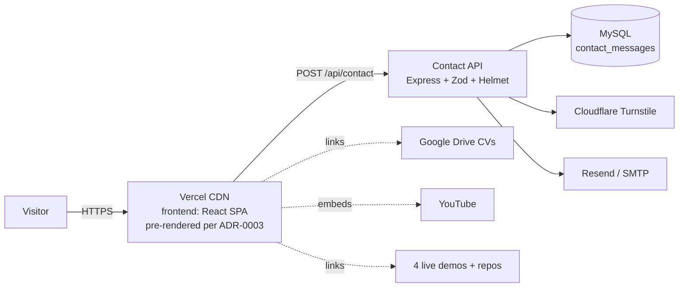

# Architecture — Hernán David Cardona Portfolio

## System context (actors and external systems)
- **Actors:** Visitor (recruiter, hiring manager); crawlers, AI tools and link unfurlers; Owner (operates the system through git and the database).
- **External systems:**
  - Vercel: hosting and CDN for the frontend.
  - API host (`api-portfolio.hernan-cardona.com`).
  - MySQL.
  - Cloudflare Turnstile (CAPTCHA).
  - Resend / SMTP (email).
  - Google Drive (CVs).
  - YouTube (demo videos).
  - GitHub (repos, GitHub Pages diagrams).
  - The 4 live demos.

## Containers (frontend, backend, database, external services)

## Modules and responsibilities
- **`frontend/src/`**
  - `components/layout` (Navbar, Footer)
  - `components/sections` (Hero, Portfolio, About, Contact)
  - `components/ui` (cards, modals, filter, icons)
  - `context` (language)
  - `hooks`
  - `data` (typed static content: the only content source)
  - `i18n` (EN/ES dictionaries)
  - `services/api` (contact client)
  - `utils` (motion presets, icons)
- **`api/src/`** — layered, following SOLID:
  - `domain/interfaces` (CaptchaVerifier, ContactRepository, MailService)
  - `application/use-cases` (SubmitContactMessageUseCase)
  - `infrastructure` (Prisma/in-memory repositories, Turnstile/Noop CAPTCHA, Resend/Nodemailer/Noop mail)
  - `interfaces/http` (routes, controllers, middlewares, validators)
  - `config/env.ts` (fail-fast env validation)

## Data, security, deployment, observability
- **Data:** content is static and compiled (see `docs/domain/model.md`). Only contact messages are persisted.
- **Security:** Helmet, a CORS allow-list, a rate limit (BR-004), Zod validation, Turnstile verified on the server, secrets in env vars only.
- **Deployment:**
  - Frontend: Vercel Git integration, root `frontend`, output `dist`.
  - API: deployed separately on its own domain (host details: owner).
- **Observability:** None beyond host logs (debt DEBT-003).

## Testing strategy
Introduced in spec 000 (today there are no automated tests):
- **Unit / component** — Vitest + Testing Library: hooks, utils, data invariants (bilingual parity, kind rules, references).
- **e2e** — Playwright with axe: critical flows (hero CTAs, card actions, modals, case study routes) on desktop and mobile viewports.
- **Pre-render check** — a script asserting content is present in the built HTML (NFR-005).
- **API** — the existing tsx scripts stay as manual diagnostics; automated API tests only if a spec touches the API.

## Decisions (ADR index)
| ADR | Title | Status |
|---|---|---|
| [ADR-0001](../adr/0001-react-vite-spa-on-vercel.md) | React + Vite + Tailwind SPA on Vercel | Accepted (retroactive) |
| [ADR-0002](../adr/0002-layered-express-contact-api.md) | Layered Express contact API with Prisma + MySQL | Accepted (retroactive) |
| [ADR-0003](../adr/0003-routing-and-prerendering.md) | Routing and pre-rendering | Accepted — Option C (custom Vite SSG) |
| [ADR-0004](../adr/0004-architecture-maps.md) | Interactive architecture maps | Accepted — Option A (native component) |
