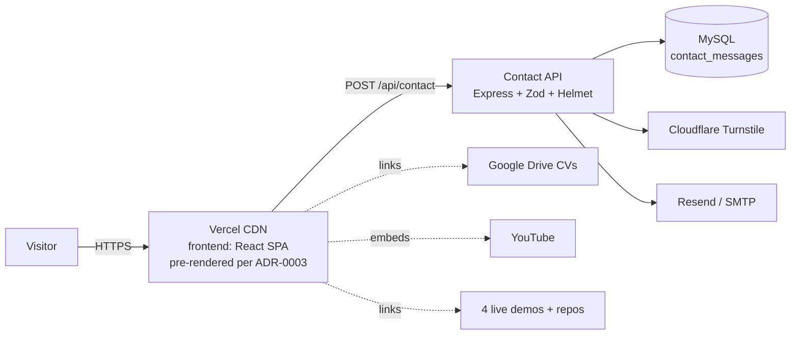

# Architecture — Hernán David Cardona Portfolio

## System context (actors and external systems)
- **Actors:** Visitor (recruiter, hiring manager); crawlers, AI tools and link unfurlers; Owner (operates the system through git and the database).
- **External systems:**
  - Vercel: hosting and CDN for the frontend.
  - API host (`api-portfolio.hernan-cardona.com`).
  - MySQL.
  - Cloudflare Turnstile (CAPTCHA).
  - Resend / SMTP (email).
  - Google Drive (CVs).
  - YouTube (demo videos).
  - GitHub (repos, GitHub Pages diagrams).
  - The 4 live demos.

## Containers (frontend, backend, database, external services)

## Modules and responsibilities
- **`frontend/src/`**
  - `components/layout` (Navbar, Footer)
  - `components/sections` (Hero, Portfolio, About, Contact)
  - `components/ui` (cards, modals, filter, icons)
  - `context` (language)
  - `hooks`
  - `data` (typed static content: the only content source)
  - `i18n` (EN/ES dictionaries)
  - `services/api` (contact client)
  - `utils` (motion presets, icons)
- **`api/src/`** — layered, following SOLID:
  - `domain/interfaces` (CaptchaVerifier, ContactRepository, MailService)
  - `application/use-cases` (SubmitContactMessageUseCase)
  - `infrastructure` (Prisma/in-memory repositories, Turnstile/Noop CAPTCHA, Resend/Nodemailer/Noop mail)
  - `interfaces/http` (routes, controllers, middlewares, validators)
  - `config/env.ts` (fail-fast env validation)

## Data, security, deployment, observability
- **Data:** content is static and compiled (see `docs/domain/model.md`). Only contact messages are persisted.
- **Security:** Helmet, a CORS allow-list, a rate limit (BR-004), Zod validation, Turnstile verified on the server, secrets in env vars only.
- **Deployment:**
  - Frontend: Vercel Git integration, root `frontend`, output `dist`.
  - API: deployed separately on its own domain (host details: owner).
  - API proxy (BUG-api-trust-proxy): nginx on the same host proxies to `localhost:4000` and
    must set `proxy_set_header X-Forwarded-For $remote_addr;` and
    `proxy_set_header X-Real-IP $remote_addr;`. The app sets `trust proxy` to `loopback`, so
    `request.ip` (rate limit, Turnstile `remoteip`) is the visitor. Any change to the proxy
    topology (a CDN, a remote proxy, another hop) requires revisiting `trust proxy`.
- **Observability:** None beyond host logs (debt DEBT-003).

## Testing strategy
Set up in spec 000. Conventions (test names with AC ids, fakes, jsdom shims): the
`testing-conventions` skill (`.harness/skills/testing-conventions/`).
- **Frontend unit / component** — Vitest 3 + Testing Library in jsdom
  (`frontend/vitest.config.ts`, which extends the Vite config; setup in `frontend/src/test/`).
  Tests sit next to the code as `*.test.ts(x)`: dictionary parity, project filter, card identity,
  filter bar, language context, theme mode.
- **API unit** — Vitest 3 in Node (`api/vitest.config.ts`): the contact schema at the BR-003
  boundaries, the submit use case with fakes, and the env config. HTTP-level and middleware tests
  are deferred (ASM-000-04). The tsx scripts (`test:e2e`, `test:persistence`, `test:smtp`) stay
  as manual diagnostics.
- **Coverage** — v8, text table plus `coverage/lcov.info` in each package; reported, not gated
  (ASM-011).
- **CI** — `.github/workflows/ci.yml`, jobs `frontend` and `api` on pull requests and pushes to
  `main`: `npm ci`, `format:check`, `lint`, `typecheck`, `test` (coverage uploaded as
  `coverage-frontend` / `coverage-api`), `build`, then guards (DEBT-005, `no-console` disables,
  this bundle baseline, harness docs, Prettier parity). Both jobs are required
  status checks on `main` (branch protection, AC-000-11, since 2026-11-26).
- **e2e** — Playwright with axe on desktop and mobile viewports: spec 004, together with the
  check that pre-rendered HTML holds the content (NFR-005). Not part of spec 000.

### Bundle baseline (NFR-002)
"Initial JS / CSS" = the gzip sizes, as printed by `vite build`, of the JS chunks and the CSS file
that `dist/index.html` references (module script + `modulepreload` links). Lazy section chunks
are excluded. Measured from a clean checkout with no `.env`, as in CI.

| Measured on | Commit | Initial JS (gzip) | Initial CSS (gzip) | Notes |
|---|---|---|---|---|
| main before spec 000 | ed051a4 | 96.46 kB | 4.24 kB | reference only |
| spec 000 baseline | 5cb5e13 | 96.62 kB | 4.24 kB | NFR-002 baseline (CI build, no VITE_* values) |

## Decisions (ADR index)
| ADR | Title | Status |
|---|---|---|
| [ADR-0001](../adr/0001-react-vite-spa-on-vercel.md) | React + Vite + Tailwind SPA on Vercel | Accepted (retroactive) |
| [ADR-0002](../adr/0002-layered-express-contact-api.md) | Layered Express contact API with Prisma + MySQL | Accepted (retroactive) |
| [ADR-0003](../adr/0003-routing-and-prerendering.md) | Routing and pre-rendering | Accepted — Option C (custom Vite SSG) |
| [ADR-0004](../adr/0004-architecture-maps.md) | Interactive architecture maps | Accepted — Option A (native component) |
