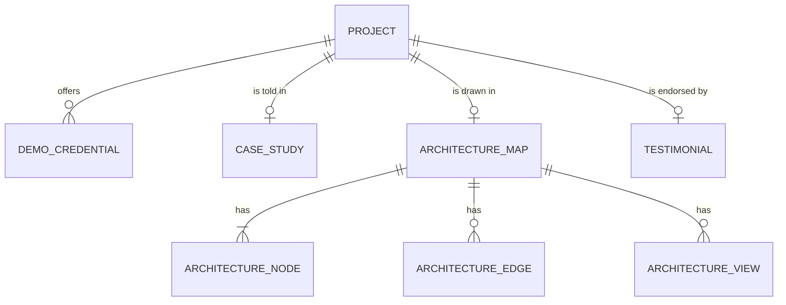
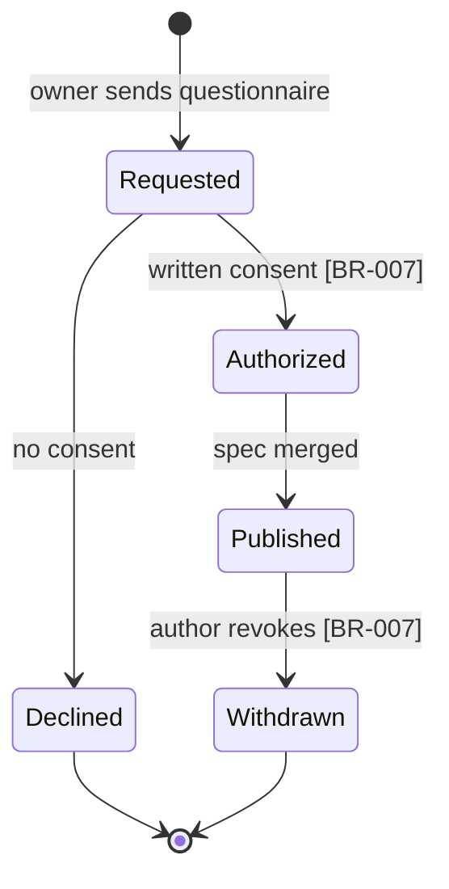

# Domain model

> Most of the domain is **static typed content** compiled into the frontend
> (`frontend/src/data/*.ts`). The only persisted entity in use is `ContactMessage` (API, MySQL).

## Entities

### Project
- **Description:** A piece of software shown as a card.
- **Key attributes:**
  - `id` (string slug, required)
  - `title` (string, required)
  - `kind` (`ProjectKind`, required — new, FR-016)
  - `description` (`{ en; es }`, required)
  - `stack` (string[], required)
  - `category` (string, required)
  - `imageUrl` (string, required)
  - `previewVideoUrl?`
  - `liveDemoUrl` (string | null)
  - `codeUrl` (string | null)
  - `demoCredentials?` (DemoCredential[])
  - `demoVideoId?` (`{ en; es }`)
  - `caseStudySlug?` (new, FR-013)
  - `architectureMapId?` (new, FR-022)
  - `testimonial?` (new, FR-021)
  - Sensitivity: public.
- **Invariants:**
  - `id` is unique.
  - Every bilingual field has both `en` and `es`.
  - `kind` follows BR-006.
  - `caseStudySlug`, if set, references an existing CaseStudy.
- **Data owner / source of truth:** Owner; positioning per BR-006.

### DemoCredential
- **Description:** A public demo account.
- **Key attributes:**
  - `role` (`{ en; es }`)
  - `username` (string | null)
  - `password` (string | null)
  - Sensitivity: public by design (fictional data).
- **Invariants:** Published only if verified by the demo audit (FR-019).
- **Data owner / source of truth:** Each project's README.

### CaseStudy (new)
- **Description:** Long-form narrative of a project.
- **Key attributes:**
  - `slug` (string, required)
  - `projectId` (string, required)
  - `title` (`{ en; es }`)
  - `sections`: problem, role, decisions[], mistakes[], result (each `{ en; es }`)
  - `sources` (string[] of repo/doc URLs)
- **Invariants:**
  - All five sections are present in both languages.
  - The slug is unique and URL-safe.
- **Data owner / source of truth:** Owner; drafted from each repo's README, `docs/` and roadmap (ASM-007).

### ArchitectureMap (new)
- **Description:** Interactive architecture diagram of one project.
- **Key attributes:**
  - `id`
  - `projectId`
  - `title` (`{ en; es }`)
  - `nodes`: ArchitectureNode[] — `id`, `kind` (owned | data | external), `label {en;es}`, `sublabel? {en;es}`, `position [x,y]`, `size [w,h]`, `zone?`, `href?`
  - `edges`: ArchitectureEdge[] — `from`, `to`, `label? {en;es}`
  - `views`: ArchitectureView[] — `id`, `label {en;es}`, `focus: nodeId[]`, `note {en;es}`
- **Invariants:**
  - Edge endpoints and view focus ids reference existing nodes.
  - Every label is bilingual.
- **Data owner / source of truth:** Owner. For FlyWorkFlow it derives from `flyworkflow.architecture.json` (Archify).

### Testimonial (new)
- **Description:** An authorized client quote.
- **Key attributes:**
  - `quote` (`{ en; es }`)
  - `authorName`
  - `authorRole` (`{ en; es }`)
  - `authorizedOn` (date)
  - Sensitivity: personal data published with consent.
- **Invariants:** Exists only with an authorization (BR-007).
- **Data owner / source of truth:** Client.

### Skill
- **Description:** A technology in the skills grid.
- **Key attributes:**
  - `id`
  - `label`
  - `iconPath`
  - `iconPathDark?`
- **Invariants:** Unique `id`.
- **Data owner / source of truth:** Owner (BR-006).

### ContactMessage (persisted)
- **Description:** A message from the contact form.
- **Key attributes:**
  - `id` (BigInt)
  - `name` (≤ 80)
  - `email` (≤ 120)
  - `message` (text)
  - `submittedAt`
  - `sourceIp?`
  - `userAgent?`
  - Sensitivity: **confidential** (personal data).
- **Invariants:** BR-003.
- **Data owner / source of truth:** MySQL `contact_messages`.

> Note: `api/prisma/schema.prisma` also defines content models (Language, Project, Skill,
> Technology, SocialPlatform …). Only the persistence smoke test reads them; the site uses the
> static data. Recorded as debt DEBT-002 in the roadmap.

## Relationships

## Life cycles

*(Testimonial life cycle. The other entities are static content with no life cycle; N/A.)*

## Data classification
| Data | Class (public / internal / confidential / restricted) | Encryption at rest | Retention |
|---|---|---|---|
| Projects, case studies, maps, skills, CV links | Public | N/A | Versioned in git |
| Demo credentials (fictional accounts) | Public | N/A | Versioned in git |
| Testimonial (name + quote) | Public with consent | N/A | Until revoked |
| Contact messages | Confidential | Per MySQL host (to confirm, OQ-005) | Undefined (OQ-005) |
| API secrets (SMTP, Turnstile, DB URL) | Restricted | Host env vars | N/A — never in repo |
