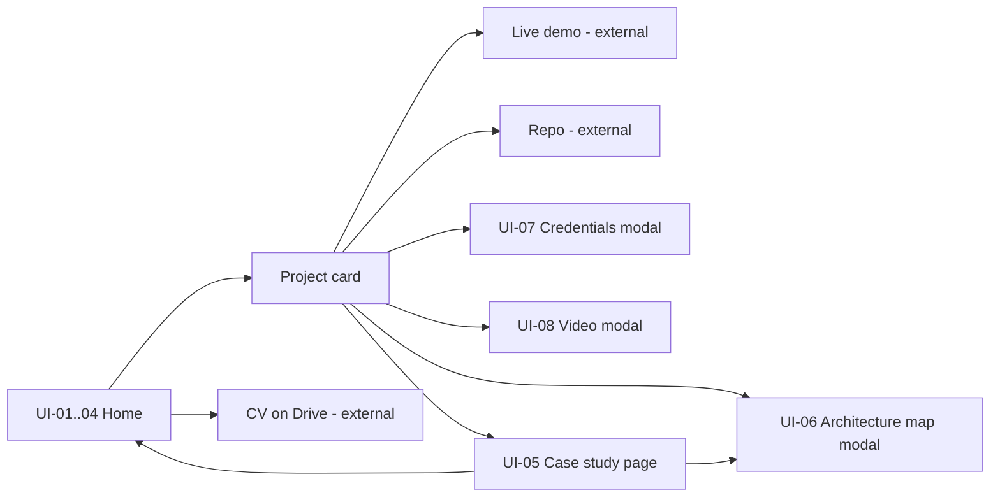

# UI Brief — Hernán David Cardona Portfolio

## 1. Direction
- **3 adjectives:** minimal, elegant, high-contrast.
- **References they like (and why):** The interactive Archify map of FlyWorkFlow (<https://hervid2.github.io/flyworkflowapp/architecture/flyworkflow.html>), because it explains a system with guided views.
- **References they dislike (and why):** N/A — not stated.
- **Visual identity:**
  - Dark theme with a cyan accent (`accent-cyan`, `accent-cyan-strong` tokens in `tailwind.config.ts`), with an optional light mode.
  - Display font for headings.
  - No new palettes (`rules/portfolio_rules.md`).
- **Information density and tone:** Low density, generous spacing; confident and concrete copy (numbers and real outcomes, no generic adjectives).

## 2. Design principles (max. 5, prioritized)
1. **Evidence over claims.** Every claim links to a demo, repo, case study or map.
2. **One click to what a recruiter needs.** CV, email and projects are reachable from the hero.
3. **Consistency with the approved mockup.** Primary CTA filled cyan, secondary outlined.
4. **Motion with restraint.** The shared presets in `utils/motionPresets.ts` are reused, and the site respects reduced motion.
5. **Bilingual by construction.** No string exists in only one language.

## 3. Screen inventory
| ID | Screen | Role(s) | Purpose | FR | Priority |
|---|---|---|---|---|---|
| UI-01 | Home — Hero | Visitor | Identity, positioning, CTAs (View work, Download CV, Copy email) | FR-001, FR-010, FR-011, FR-017 | Must |
| UI-02 | Home — Portfolio grid + cards | Visitor | Projects with kind label, actions, filter | FR-004–FR-007, FR-014–FR-016, FR-019, FR-022 | Must |
| UI-03 | Home — About + Skills | Visitor | Bio, location, market, skills | FR-009, FR-018 | Should |
| UI-04 | Home — Contact | Visitor | Form + CV + copy email + social links | FR-008, FR-010, FR-011 | Must |
| UI-05 | Case study page (`/case-studies/<slug>`) | Visitor | Long-form narrative | FR-013, FR-021 | Must |
| UI-06 | Architecture map modal | Visitor | Interactive map with views | FR-022 | Should |
| UI-07 | Credentials modal (existing) | Visitor | Demo accounts | FR-006 | Should |
| UI-08 | Video modal (existing) | Visitor | Demo video | FR-007 | Could |

## 4. Navigation per role

## 5. Interaction patterns
- **Tables:** N/A.
- **Forms:** The existing contact form, with inline validation and Turnstile.
- **States:**
  - Loading: skeleton or spinner for lazy sections and the map.
  - Error: the map fails to load → message plus link to the repo.
  - Success: "Copied" toast or inline label for 1.5–2 s.
- **Notifications:** Inline only.
- **Destructive actions:** N/A.
- **Modals:** Trap focus, close with Esc or the backdrop, return focus to the trigger.

## 6. Accessibility and responsiveness
- **WCAG target:** 2.2 AA.
- **Priority:** Desktop first in importance; mobile-first in CSS (`rules/portfolio_rules.md`).
- **Breakpoints:** Tailwind defaults (`md` 768, `lg` 1024).
- **Architecture map on mobile:** Pan and zoom by touch, with a "views" list as an accessible alternative to the canvas.

## 7. Localization
- **Languages:** EN (default) and ES.
- **Dates:** "Jun–Oct 2026" style in EN, "jun–oct 2026" in ES.
- **Currencies / units:** N/A.
- **Time zone shown:** UTC-5 (About).

## 8. Assets and links
- The approved mockup: referenced in `rules/portfolio_rules.md`.
- Existing diagrams:
  - FlyWorkFlow Archify JSON: <https://github.com/hervid2/flyworkflowapp/tree/main/docs/architecture>
  - Slicing Edge map: <https://hervid2.github.io/Slicing-edge-e-commerce/architecture/>
  - Sushi Burrito Web: <https://hervid2.github.io/SushiBurritoFinal/>
- Open Graph image: to be designed in spec 005 (1200×630, dark/cyan).
